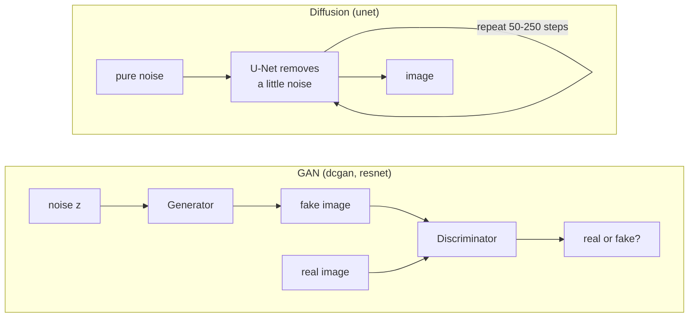
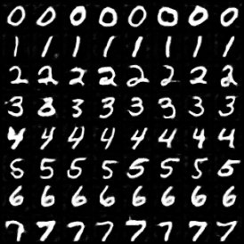
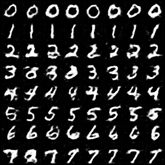
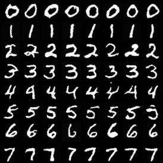

# anim-gen

**Generate images of animals (and digits, and objects) with GANs and diffusion models, in plain PyTorch.**

[](LICENSE)
[](pyproject.toml)
[](https://pytorch.org)
[](https://huggingface.co/datasets/huggan/AFHQ)

Three generative architectures behind one training loop, one sampler and
one checkpoint format:

| `--arch` | family | what it is |
|---|---|---|
| `dcgan` | GAN | the classic DCGAN, for any power-of-two resolution |
| `resnet` | GAN | SNGAN / BigGAN-style ResNet: spectral norm, hinge loss, conditional BatchNorm, projection discriminator, self-attention, DiffAugment |
| `unet` | diffusion | DDPM U-Net with cosine schedule, ε- or v-prediction, DDIM sampling and classifier-free guidance |

All of them can be **class-conditional** ("draw a cat"), keep an **EMA**
copy of the weights for sampling, train on a CPU, one GPU, several GPUs or
several machines, and come with named presets for MNIST, CIFAR-10 and
**AFHQ** (high-quality animal faces: cat / dog / wild).



## Results

CPU sanity runs (shared, heavily loaded 8-core CPU; no GPU). Conditional models: row r = digit r.

| DCGAN, non-saturating loss, 4k steps | DCGAN, LSGAN + R1, 3k steps | diffusion U-Net (0.44M), v-prediction, 2.5k steps |
|---|---|---|
|  |  |  |

Every architecture and GAN loss was trained on MNIST; the full record (including what
did *not* work, e.g. ε-prediction backgrounds and WGAN-GP with a BatchNorm critic) is in
[docs/testing.md](docs/testing.md#3-sanity-runs-on-real-data).

AFHQ (16,130 images: 5,653 cat / 5,239 dog / 5,238 wild) is prepared at 64 and 128 px with
`anim-prepare`; full CIFAR-10 / AFHQ training needs a GPU (use the notebook). No pretrained
weights are published yet.

## Quick start

```bash
# 1. install (Python >= 3.10)
python -m venv .venv
source .venv/bin/activate
pip install -e '.[dev]'          # CPU-only torch: see docs/training.md

# 2. check everything works (CPU, no network, ~2 min)
pytest

# 3. a first real model: conditional DCGAN on MNIST (one digit per row of the grid)
anim-train --preset mnist-dcgan --conditional --steps 4000 --output-dir checkpoints/mnist-dcgan

# 4. generate
anim-sample --checkpoint checkpoints/mnist-dcgan/last.pt --class 7 --num 16 --out sevens.png

# 5. the real thing: animal faces (needs a GPU; see the Kaggle/Colab notebook)
pip install -e '.[hf]'
anim-prepare --source hf:huggan/AFHQ --sizes 64 --out 'data/afhq{size}'
anim-train --preset afhq64-resnet --output-dir checkpoints/afhq64-resnet
```

`anim-train --list-presets` shows every preset; any setting can be
overridden with a flag (`anim-train --preset cifar10-resnet --batch-size 128`).

## Documentation

| Guide | What is inside |
|-------|----------------|
| [notebooks/train_colab_kaggle.ipynb](notebooks/train_colab_kaggle.ipynb) | **Train on a free Kaggle or Colab GPU**: self-contained, pick a preset, live dashboard (losses + newest samples), resumable |
| [docs/training.md](docs/training.md) | Presets, CPU / GPU / multi-GPU / multi-node, resume, FID during training, tuning tips |
| [docs/datasets.md](docs/datasets.md) | MNIST, CIFAR-10, AFHQ, your own folder or zip of photos |
| [docs/sampling.md](docs/sampling.md) | Generate images (CLI and Python), class control, latent walks, guidance, FID |
| [docs/architecture.md](docs/architecture.md) | How each model, loss and the diffusion process work, with diagrams and design choices |
| [docs/testing.md](docs/testing.md) | The test suite, and the measured sanity runs |

## Repository layout

```
src/anim_gen/            the package
  config.py              every hyperparameter (DataConfig, ModelConfig, TrainConfig) + PRESETS
  data.py                MNIST / Fashion-MNIST / CIFAR-10 / image folders / procedural shapes
  models/
    dcgan.py             DCGAN generator and discriminator
    resnet_gan.py        ResNet GAN (SNGAN / BigGAN style)
    unet.py              diffusion U-Net
    layers.py            spectral norm, conditional BatchNorm, self-attention
  losses.py              non-saturating, hinge, WGAN-GP, LSGAN, R1
  diffaugment.py         differentiable augmentation for small datasets
  diffusion.py           noise schedules, training loss, DDIM / DDPM sampler, guidance
  ema.py                 exponential moving average of the weights
  tasks.py               GANTask / DiffusionTask: one interface for both families
  runtime.py             device, precision, multi-GPU helpers
  train.py               training loop + anim-train CLI
  sample.py              anim-sample CLI (grids, per-class, interpolation)
  fid.py                 FID + anim-fid CLI
  prepare.py             anim-prepare CLI (AFHQ / folders / zips -> resized class folders)
  images.py              tensor <-> PNG helpers
notebooks/               Kaggle / Colab notebook (+ the script that builds it from src/)
tests/                   pytest suite (CPU only, offline)
docs/                    guides and result images
legacy/                  the original Colab notebook, kept for reference (and what was fixed)
```

## Status and next steps

- [x] DCGAN, ResNet GAN, diffusion U-Net; four GAN losses; R1, WGAN-GP, DiffAugment; EMA
- [x] Class-conditional generation for all three; classifier-free guidance for diffusion
- [x] Presets for MNIST, CIFAR-10, AFHQ 64/128; AFHQ preparation from the Hugging Face Hub
- [x] CPU, single-GPU, multi-GPU and multi-node training; bf16; resume; time budget
- [x] FID (training-time and `anim-fid`); Kaggle/Colab notebook; tests
- [x] Sanity runs on CPU (MNIST, see Results)
- [ ] Full GPU runs on CIFAR-10 and AFHQ, with FID, and published checkpoints
- [ ] StyleGAN2-style generator (mapping network, modulated convs) for AFHQ 256+
- [ ] Latent diffusion (autoencoder + U-Net in latent space) for 256+

## License

[MIT](LICENSE)
