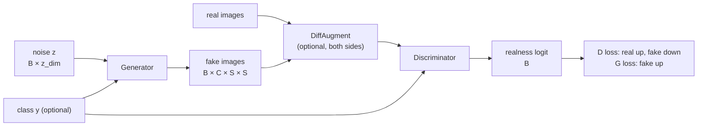
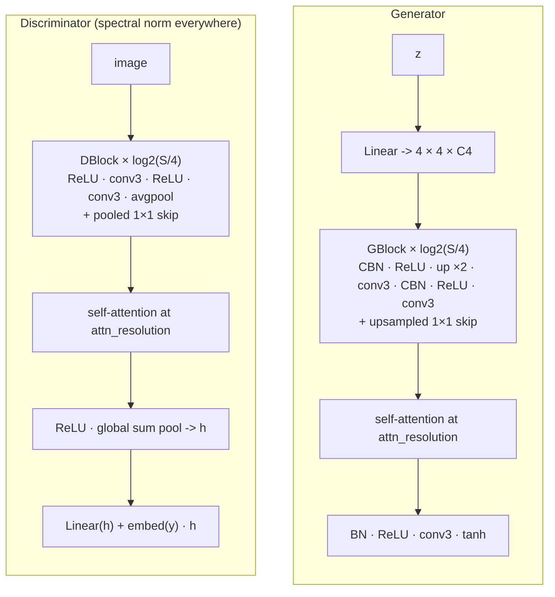
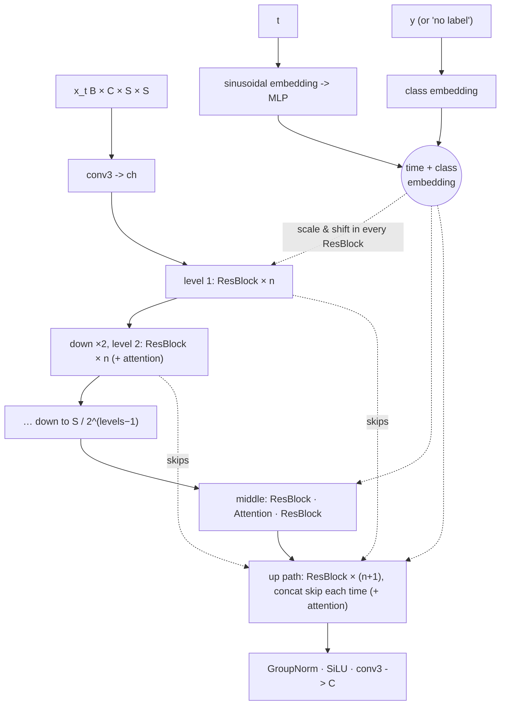
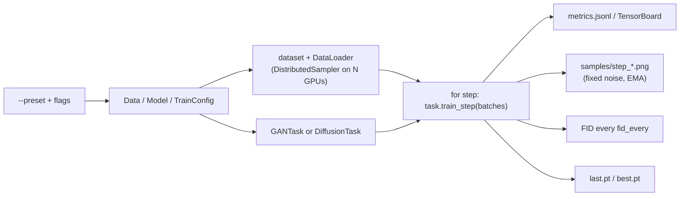

# How the models work

Two families of generative models, three architectures, one training loop.
B = batch size, C = image channels (1 or 3), S = image size, K = number of classes.

| `arch` | family | idea | best for |
|---|---|---|---|
| `dcgan` | GAN | the classic: transposed convs up, strided convs down | MNIST, quick baselines |
| `resnet` | GAN | residual blocks, spectral norm, conditional BN, self-attention, projection D | CIFAR-10, AFHQ at 64–128 px |
| `unet` | diffusion | learn to remove noise, then generate by denoising pure noise | best quality, slower to sample |

All images live in **[-1, 1]**: the generator ends with `tanh`, and diffusion
noise is a standard Gaussian, so both match the data scale.

## 1. Data (`data.py`)

```
dataset item:  image [C, S, S] in [-1, 1],  label (int)
```

Resize the short side → centre crop → (optional) random horizontal flip →
`[-1, 1]`. Flips are on by default except for digits (a flipped 3 is not a 3).
A folder with sub-folders gives one class per sub-folder (`afhq64/cat`, ...).

## 2. GANs (`models/dcgan.py`, `models/resnet_gan.py`, `tasks.py`)

A generator G maps noise z ~ N(0, I) to an image; a discriminator D scores
how real an image looks. They are trained against each other:



One training step (`GANTask.train_step`):

1. `d_steps` times: draw a real batch, make fakes **without** gradients into G,
   compute the D loss (+ gradient penalty / R1), update D.
2. Freeze D, make fresh fakes, compute the G loss through D, update G.
3. Update the **EMA** copy of G, which is the one used for sampling.

### DCGAN

```
G: z [B, z_dim(+z_dim label embedding)] -> ConvT 4x4 -> BN -> ReLU   (4 x 4)
   -> [ConvT 4x4 stride 2 -> BN -> ReLU] x n                         (8, 16, ... S/2)
   -> ConvT 4x4 stride 2 -> tanh                                      (S x S)
D: image -> Conv 4x4 s2 -> LeakyReLU -> [Conv 4x4 s2 -> BN or SN -> LeakyReLU] x n
   -> flatten 4x4 features -> Linear -> logit (+ class projection)
```

Width doubles at every lower resolution (`g_channels`, `d_channels`, capped at
`max_channels`). Weights start from N(0, 0.02), as in the paper.

### ResNet GAN (SNGAN / SAGAN / BigGAN style)



Design choices, and why:

- **Spectral normalisation** on every D layer keeps D 1-Lipschitz (its output
  cannot change faster than its input), the most effective single GAN
  stabiliser (Miyato et al. 2018).
- **Hinge loss** with Adam(β1 = 0, β2 = 0.9): the SNGAN / BigGAN recipe.
- **Conditional BatchNorm** (per-class scale and shift) in G and a
  **projection discriminator** (`embed(y) · h`) for class conditioning: much
  better than concatenating one-hot labels.
- **Self-attention** at one resolution lets distant regions agree (two eyes
  of the same face). Its output gate γ starts at 0, so it starts as identity.
- **Orthogonal init** (BigGAN).
- **DiffAugment** (Zhao et al. 2020): with ~5k images per AFHQ class, D
  memorises the training set and training collapses; differentiable colour /
  translation / cutout on both real and fake images prevents that.
- **EMA generator**: sampling from an average of recent weights gives clearly
  better images than the raw generator.

### GAN losses (`losses.py`)

| `loss` | D minimises | G minimises |
|---|---|---|
| `nonsaturating` | softplus(−D(x)) + softplus(D(G(z))) | softplus(−D(G(z))) |
| `hinge` | relu(1 − D(x)) + relu(1 + D(G(z))) | −D(G(z)) |
| `wgan-gp` | D(G(z)) − D(x) + λ·GP | −D(G(z)) |
| `lsgan` | ½(D(x) − 1)² + ½D(G(z))² | ½(D(G(z)) − 1)² |

`softplus(−l)` is exactly `BCE(sigmoid(l), 1)`, without overflow. Optional
**R1** (`--r1-gamma`) penalises ‖∇D(x)‖² on real images.

## 3. Diffusion (`diffusion.py`, `models/unet.py`)

Forward process (fixed, no learning):

```
x_t = sqrt(ᾱ_t) · x_0 + sqrt(1 − ᾱ_t) · ε,   ε ~ N(0, I),   t = 0 … T−1
```

ᾱ_t falls from ≈ 1 (clean) to ≈ 0 (pure noise), following a **cosine**
schedule (Nichol & Dhariwal 2021) or the original **linear** one.

**Training**: pick t at random, noise the image, and regress the U-Net output
on a target with a plain MSE:

- `prediction = "eps"`: the noise ε (DDPM),
- `prediction = "v"`: v = sqrt(ᾱ_t)·ε − sqrt(1 − ᾱ_t)·x_0 (better at higher resolution).

**Sampling** (DDIM, Song et al. 2021): start from pure noise and repeat
"estimate x_0, step to a less noisy t". `eta = 0` is deterministic and good
with 50–250 steps; `eta = 1` with all T steps is the original DDPM sampler.

**Classifier-free guidance**: in training the label is dropped 10% of the
time (replaced by a "no label" id), so one network learns both p(x | y) and
p(x). At sampling time both predictions are mixed:
`pred = uncond + s · (cond − uncond)`; s > 1 trades diversity for fidelity.

### U-Net



- **ResBlock**: GroupNorm · SiLU · conv3, then FiLM `h · (1 + scale) + shift`
  from the embedding, GroupNorm · SiLU · dropout · conv3, + skip.
- **Attention** at the resolutions in `attn_resolutions` (16 and/or 8).
- The last conv of every residual branch and of the output is
  **zero-initialised**: the untrained network is the identity on each block
  and predicts zero, which makes early training stable.
- Width per level = `unet_channels × channel_mult[level]`; the CIFAR-10 preset
  (128, (1, 2, 2, 2), 2 blocks, attention at 16) is the DDPM paper's 35.7M-param
  model (38M here with the class embedding).

## 4. Training loop (`train.py`)



- Training is counted in **steps** (generator or denoiser updates), not epochs.
- **Multi-GPU** without DDP: each process computes its gradients and one
  all-reduce averages them before every optimizer step (`runtime.sync_gradients`).
  DDP cannot do the double backward that WGAN-GP and R1 need; this can, and
  the tests check that two processes end with identical weights.
- **Mixed precision**: bf16 autocast on Ampere+ GPUs. No fp16: GAN losses and
  gradient penalties overflow too easily.
- **Checkpoints** hold the weights, EMA weights, optimizer and scheduler
  states, RNG states and all three configs; `anim-sample` rebuilds the model
  from them with no extra flags.

## 5. FID (`fid.py`)

Fréchet Inception Distance between the Inception-v3 pool features of real and
generated images: ‖μ_r − μ_g‖² + Tr(Σ_r + Σ_g − 2 (Σ_r Σ_g)^½). Lower is
better. It uses torchvision's Inception weights, so values are close to but
not identical with published (TensorFlow) FIDs; compare runs of this repo with
each other, at the same sample count.
